# MANUAL DE USUARIO

## Software: PsicoRapport

**Versión documentada:** aplicación Android / PWA PsicoRapport  
**Idioma:** Español  
**Público:** usuarios finales (consultantes) y, en sección aparte, terapeutas  
**Fecha:** 18 de noviembre de 2026  
**Titular / editor del manual:** [COMPLETAR: nombres y apellidos]

---

## 0. Nota para la evaluación (INDECOPI)

Este manual describe **cómo se usa** el programa depositado. Complementa —no sustituye— la **memoria descriptiva** (qué es y cómo está construido) y el **código fuente** (expresión programática).

Las **Figuras 1–12** están incluidas en este documento (carpeta `capturas/`) y muestran las pantallas principales del flujo de uso.

---

## 1. ¿Qué es PsicoRapport?

PsicoRapport es una aplicación de acompañamiento emocional que te permite:

- Conversar con tu compañero virtual (mascota personalizable, **Qori**).  
- Registrar cómo te sientes.  
- Cuidar y personalizar tu mascota (Objeto Digital Transicional).  
- Participar en una comunidad de apoyo.  
- Encontrar y vincularte con psicólogos / terapeutas verificados.  
- Ver tu progreso (puntos, rachas, etapa del camino).

**Importante:** PsicoRapport **no** es un psicólogo, psiquiatra ni servicio de emergencia. No diagnostica ni reemplaza terapia profesional. En crisis, contacta servicios locales de emergencia o la **línea 113** (Perú).

---

## 2. Requisitos

| Requisito | Detalle |
| --- | --- |
| Dispositivo | Teléfono Android compatible (app) o navegador moderno (PWA) |
| Cuenta | Cuenta de Google para iniciar sesión |
| Conexión | Internet |
| Edad | 18+; si eres menor, autorización de padre/madre/tutor |

---

## 3. Instalación e inicio

### 3.1 Pantalla de bienvenida (Figura 1)

Al abrir la aplicación aparece la pantalla inicial con el mensaje de espacio seguro y el botón **Empezar**.

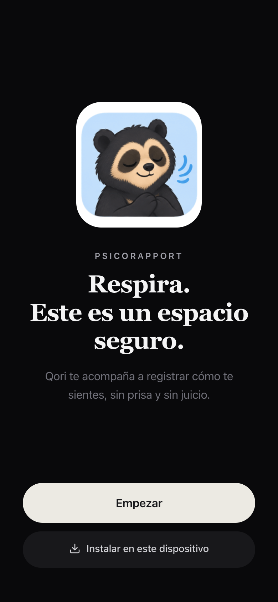

*Figura 1. Pantalla de inicio de PsicoRapport.*

### 3.2 Instalación

1. Instale el archivo de la aplicación proporcionado (APK / tienda / AAB de distribución).  
2. Abra **PsicoRapport**.  
3. Si usa la versión web/PWA, puede agregarla a la pantalla de inicio cuando el sistema lo ofrezca.

### 3.3 Inicio de sesión (Figura 2 — Login)

1. Pulse el botón de acceso con Google.  
2. Elija su cuenta y autorice el acceso básico (perfil / correo).  
3. Si es la primera vez, continuará al **consentimiento informado**.

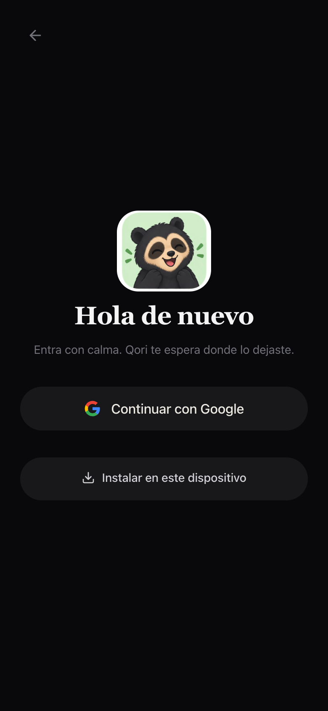

*Figura 2. Acceso con cuenta de Google.*

---

## 4. Consentimiento informado (Figura 3)

Antes de usar las funciones principales debe:

1. Leer el texto de consentimiento (desplácese hasta el final).  
2. Marcar las casillas de comprensión (naturaleza del servicio, no es terapia, privacidad, crisis).  
3. Aceptar para continuar.

Sin este paso, el sistema no habilita el resto de módulos.

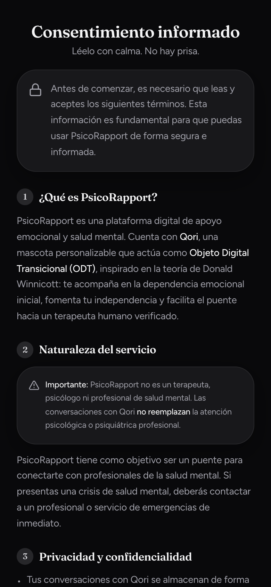

*Figura 3. Lectura y aceptación del consentimiento informado.*

---

## 5. Onboarding / preferencias (Figura 4)

Complete los datos iniciales que el sistema solicita (por ejemplo: información de acompañamiento, motivo, preferencia de estilo terapéutico y personalización de la mascota).  
Estos datos ayudan a personalizar el acompañamiento y las recomendaciones de profesionales.

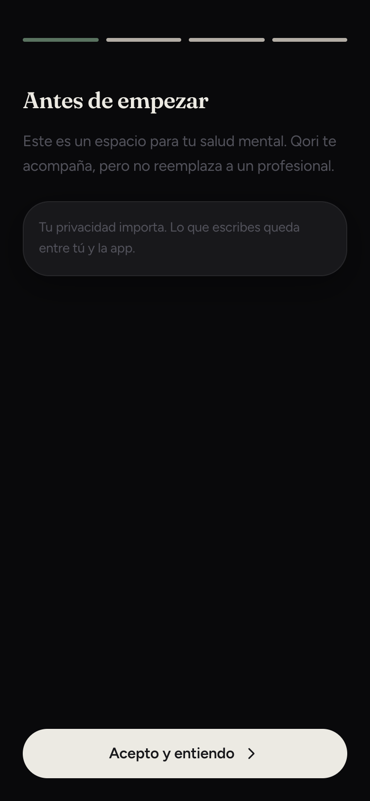

*Figura 4. Primer paso del onboarding (“Antes de empezar”).*

---

## 6. Pantalla principal: chat con tu mascota (Figura 5)

Ruta principal de acompañamiento.

### 6.1 Cómo conversar

1. Escriba un mensaje en el cuadro de texto.  
2. Envíe el mensaje.  
3. Reciba la respuesta de su compañero virtual (por defecto, **Qori**).  

Puede hablar de cómo se siente, pedir calma, preguntar por su progreso o por profesionales disponibles.

### 6.2 Acciones sugeridas

En algunos casos la app muestra botones/atajos, por ejemplo:

- Registrar ánimo  
- Cuidar a la mascota  
- Ver psicólogos / matching  
- Llamar a línea de crisis (113)

### 6.3 Etapas del camino

El sistema reconoce etapas:

1. **Dependencia** — acompañamiento cercano con la mascota.  
2. **Independencia** — mayor autonomía (tras uso sostenido: ánimo, cuidados, chat o racha).  
3. **Puente terapéutico** — cuando se vincula con un terapeuta humano.

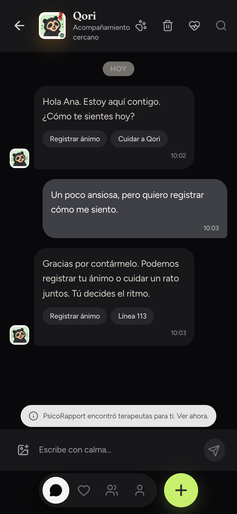

*Figura 5. Chat de acompañamiento con la mascota y atajos de acción.*

---

## 7. Mascota virtual (Figura 6)

Desde la sección de mascota usted puede:

1. Ver el estado (hambre, felicidad, energía) y la emoción actual.  
2. **Personalizar** nombre (dentro del límite permitido), color y accesorio.  
3. **Cuidar** la mascota:  
   - Alimentar  
   - Jugar  
   - Descansar  

Si no la cuida por un tiempo, sus indicadores pueden bajar (decaimiento).

Las caras de emoción (triste, enojado, temeroso, calma, motivado, feliz) reflejan el estado vinculado al ánimo / cuidado.

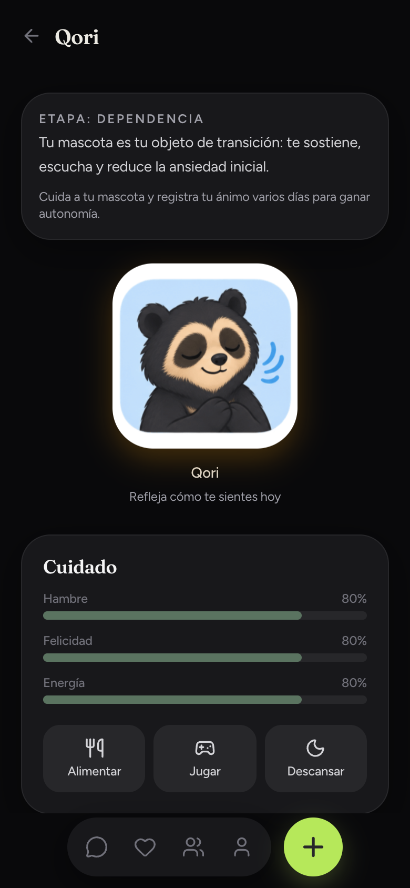

*Figura 6. Pantalla de cuidado y estado de la mascota.*

---

## 8. Registro de estado de ánimo (Figura 7)

1. Ingrese a la sección de seguimiento / diario de ánimo.  
2. Seleccione la emoción que mejor describe cómo se siente.  
3. Guarde el registro.  

Los registros alimentan estadísticas, la mascota y el contexto del chat.

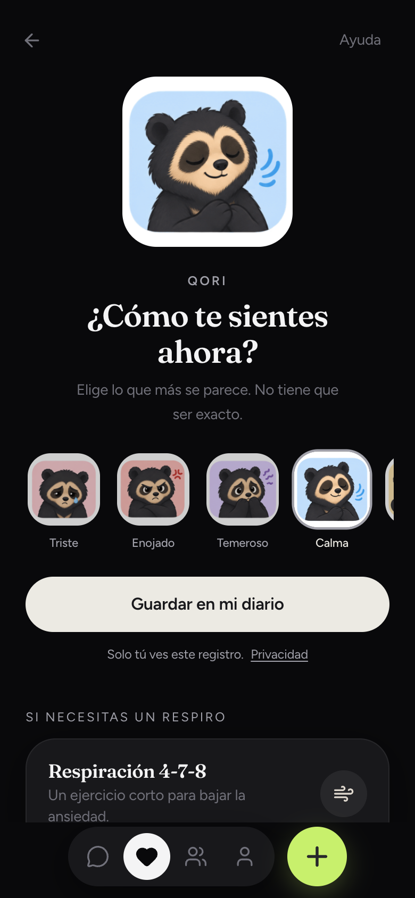

*Figura 7. Selección y registro del estado de ánimo.*

---

## 9. Comunidad (Figura 8)

1. Lea publicaciones de otras personas y de terapeutas verificados.  
2. Reaccione con “Me Importa” o comente (con el límite diario si no es terapeuta).  
3. Solo terapeutas verificados pueden crear publicaciones nuevas.  

Recibirá notificaciones cuando interactúen con sus publicaciones (si las notificaciones están activas).  
Mantenga un tono respetuoso; no es un espacio de diagnóstico entre pares.

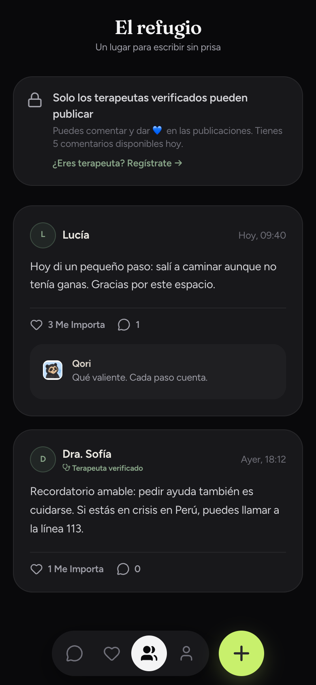

*Figura 8. Feed de la comunidad de apoyo.*

---

## 10. Terapeutas y matching (Figuras 9 y 10)

### 10.1 Explorar profesionales (Figura 9)

1. Abra el listado de terapeutas.  
2. Revise fichas (especialidad, enfoque, presentación).  
3. Elija un profesional cuando se sienta listo.

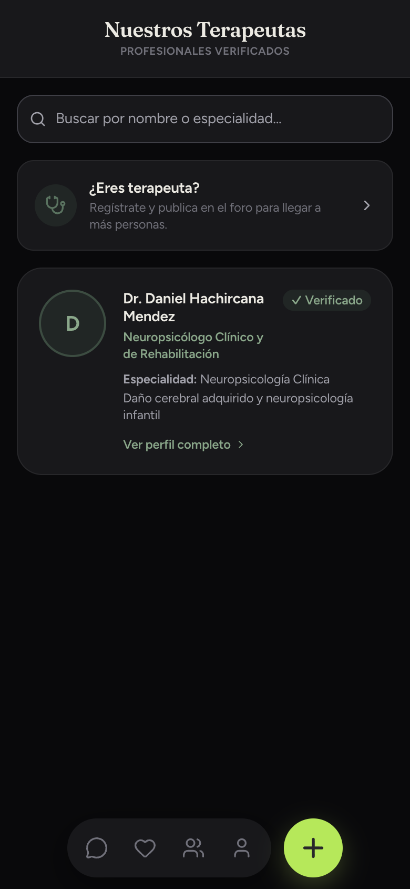

*Figura 9. Exploración de terapeutas verificados.*

### 10.2 Matching (Figura 10)

Use el flujo de matching para orientar la búsqueda según preferencias (p. ej. estilo terapéutico).  
El vínculo con un profesional se asocia a la etapa de **puente terapéutico**.

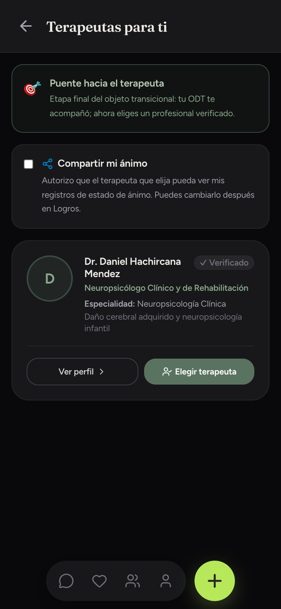

*Figura 10. Flujo de matching / elección de terapeuta.*

---

## 11. Progreso y estadísticas (Figura 11)

Consulte:

- Puntos acumulados por acciones de autocuidado  
- Rachas de uso  
- Resumen de actividad (chat, ánimo, cuidados, comunidad)  
- Etapa actual del camino  
- Gráfico de ánimo reciente  

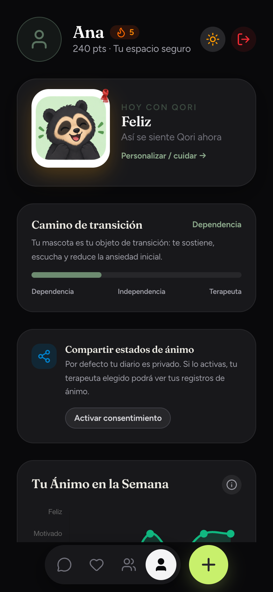

*Figura 11. Perfil, puntos, etapa y seguimiento de ánimo.*

---

## 12. Navegación

La barra inferior (dock) permite saltar entre las secciones principales (chat, ánimo, comunidad, perfil/progreso, según la versión). El botón “+” da acceso rápido a acciones frecuentes (p. ej. mascota).  
En Android, el botón “atrás” sigue el historial de pantallas; en pantallas raíz puede cerrar la app.

---

## 13. Manual breve para terapeutas (Figura 12)

1. Inicie sesión con Google.  
2. Complete el registro de terapeuta (datos profesionales, especialidad, biografía, etc.).  
3. Espere la verificación / aprobación según el flujo administrativo.  
4. Una vez aprobado, su perfil podrá aparecer para usuarios en búsqueda / matching y podrá publicar en la comunidad.

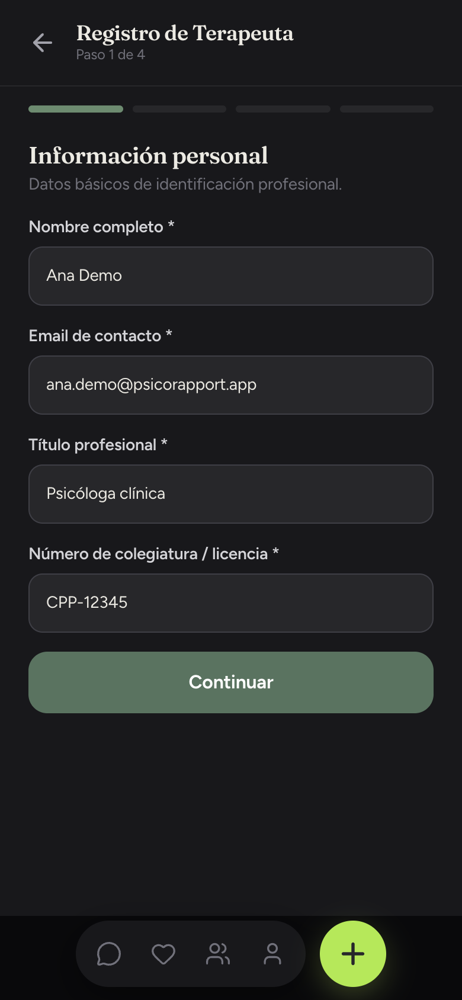

*Figura 12. Formulario de registro profesional para terapeutas.*

---

## 14. Privacidad y seguridad (resumen para el usuario)

- Se solicitan datos necesarios para la cuenta y el acompañamiento.  
- Usted controla el consentimiento informado.  
- No comparta datos sensibles de terceros en la comunidad.  
- Para eliminar cuenta o ejercer derechos, contacte a: [COMPLETAR: correo de soporte].

---

## 15. Solución de problemas frecuentes

| Problema | Qué intentar |
| --- | --- |
| No inicia sesión | Verificar Internet y cuenta Google; reintentar |
| Lo envían siempre al consentimiento | Completar casillas y aceptar |
| No carga el chat | Verificar conexión; reabrir la app |
| No llegan notificaciones | Activar permisos de notificación del sistema |
| La mascota “baja” de ánimo | Usar acciones de cuidado (alimentar / jugar / descansar) |

---

## 16. Contacto

- Soporte: [COMPLETAR: correo]  
- Titular del software: [COMPLETAR: nombre]

---

## 17. Índice de capturas (Anexo A)

| Figura | Archivo | Pantalla |
| --- | --- | --- |
| 1 | `capturas/01-inicio.png` | Bienvenida |
| 2 | `capturas/02-login.png` | Login con Google |
| 3 | `capturas/03-consentimiento.png` | Consentimiento informado |
| 4 | `capturas/04-onboarding.png` | Onboarding / preferencias |
| 5 | `capturas/05-chat.png` | Chat con la mascota |
| 6 | `capturas/06-mascota.png` | Cuidado de mascota |
| 7 | `capturas/07-animo.png` | Registro de ánimo |
| 8 | `capturas/08-comunidad.png` | Comunidad |
| 9 | `capturas/09-terapeutas.png` | Listado de terapeutas |
| 10 | `capturas/10-matching.png` | Matching |
| 11 | `capturas/11-estadisticas.png` | Perfil y estadísticas |
| 12 | `capturas/12-registro-terapeuta.png` | Registro de terapeuta |

### Otros anexos del expediente

| Anexo | Contenido |
| --- | --- |
| Anexo A | Capturas Figuras 1–12 (esta carpeta) |
| Anexo B | Ejecutable AAB/APK |
| Anexo C | Memoria descriptiva |
| Anexo D | Partes sustanciales del código fuente |

**Fin del manual de usuario.**
